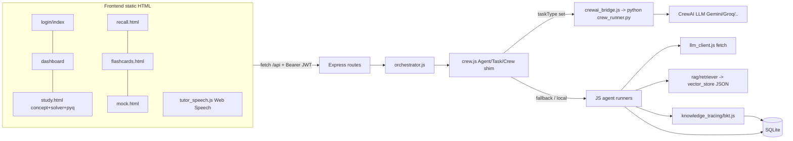
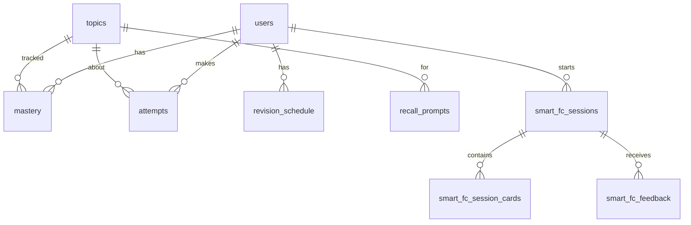

> **Historical document:** this audit describes the project BEFORE the fixes; see docs/FINAL_REPORT.md and docs/CHANGES.md for the current state.

# Report B — Detailed Technical Architecture

## 1. System diagram


## 2. Frontend
Plain HTML/CSS/JS, one `styles.css` (1342 lines, 3 `@media`). `app.js`: `Auth` (localStorage token), `apiCall`, `renderHeader`, `quickDemoLogin` (auto-creates `demo_aspirant@edugraph.ai` with a hardcoded password), `formatInlineMarkdown` (regex → `innerHTML`). `study.html` (958 lines) hosts Concept Study, PYQ practice and Problem Solver views; `concept.html`, `pyq.html`, `solver.html` are 14-line redirects. 44 `innerHTML` assignments across pages; only `formatInlineMarkdown` and a few ad-hoc escapes exist (no DOMPurify).

## 3. Backend routes (all under `/api`)
| Prefix | Endpoints | Auth |
|---|---|---|
| auth | POST signup, login; GET me | none / required |
| learner | GET mastery, attempts, weak-topics, streak, dashboard | required |
| syllabus | GET topics, subjects, path/:id | optional |
| agents | POST concept, pyq-analyst, solve; GET token-report | optional / **none** |
| revision | GET schedule | required |
| recall | GET prompt; POST grade, submit; GET history | optional / required |
| mock | GET start; POST submit | optional |
| flashcards | GET/POST smart-session, POST feedback, GET smart-history, topic-classification, GET /, POST generate | optional |
| tts | GET config; POST normalize, speak | optional |
| quick-actions | POST /:action (5 presets) | optional |

## 4. Database design

Tables: `users, topics, mastery(p_know), attempts, revision_schedule, agent_logs, recall_prompts, smart_fc_*` + lazily-created `response_cache`, `token_logs`. Notes: `attempts.topic_id` is an FK → any unknown topic crashes the request. `recall_prompts` is global (not per user) and rows accumulate forever. No indices beyond PKs. No migration tooling. `data/edugraph.db-wal/-shm` are committed to git although `edugraph.db` is ignored.

## 5. AI architecture
- **Agent shim (`crew.js`)**: `Agent{role,goal,backstory,tools,runner,taskType}`, `Task`, `Crew.kickoff()` loops tasks sequentially. Every orchestrator method builds **one Agent + one Task**. There is no hierarchical process, no delegation, no shared memory, no output validation.
- **Python path**: only for `concept`, `pyq`, `solve`, `recall_grade`. Real `crewai.Agent/Task/Crew` objects, one agent, one task. If `crewai` import fails, no LLM is configured, or anything throws, `crew_runner.py` returns **hardcoded templates** (`synthesize_grounded_concept` etc.) that still report `grounded: true`.
- **Agents in code** vs. the intended nine:

| Intended | In code? | Instantiated | CrewAI-executed | LLM | Notes |
|---|---|---|---|---|---|
| Syllabus | yes | yes | no | no | DAG lookup + BKT readiness; plain function |
| Concept Teacher | yes | yes | yes (python) | yes | + 12 hardcoded curated answers |
| PYQ Analyst | yes | yes | yes (python) | yes | stats from JSON |
| Problem Solver | yes | yes | yes (python) then **also** local run | yes | double work, see below |
| Doubt Debugger | **no** | – | – | – | quick_actions.js are prompt presets on Concept Teacher |
| Revision | yes | yes | no | no | arithmetic ranking; "agent" in name only |
| Mock Test | yes | yes | no | no | random sample + scoring |
| Interview | **no** | – | – | – | – |
| Active Recall | yes | yes | grade only | yes | generate = direct Gemini call |

- **Autonomous agent vs LLM call vs function**: a true agent chooses tools/steps from LLM reasoning. Here the Python crews give agents `tools=[...]`, so only those crews can (in principle) do tool-calling; every other "agent" is either a single LLM call (Concept/PYQ/Recall in JS) or a deterministic Python-style function (Syllabus, Revision, Mock Test). Agents never exchange messages. CrewAI is **genuinely used** but in its thinnest form (single agent/single task) and as a subprocess.
- **Double execution**: for `solve` with a student answer, `crew.js:executeTask` spawns Python (which itself runs `synthesize_grounded_problem_solve` and then a crew LLM call) **and** then runs the JS `ProblemSolverAgent.run`, which may call the LLM again → up to 2 LLM calls + a process spawn for one click.

## 6. RAG pipeline (as implemented)
`syllabus.json` (27 topic descriptions) + 23 PYQs → one text chunk per item (**50 chunks**, no splitting) → `generateEmbedding()`: 512-dim **feature-hashing** (FNV-1a of unigram tokens + 3-char n-grams, L2-normalised; *not* a learned embedding) → JSON file → `search()` linear scan: `score = 0.35·cosine + 0.65·token-overlap` → `retrieve()` dedups (>0.85 overlap), keeps topK (default 3; concept uses 2), truncates chunks to 200 chars, `isGrounded = (score≥0.25 ∧ overlap≥0.20) ∨ (overlap≥0.40 ∧ score≥0.14)`. Metadata filters: subject, topic_id, source_type. No reranker, no upload/PDF/ingestion, no chunk overlap, no query rewriting. The Python `RAGKnowledgeTool` is a *separate* keyword scorer over the same JSON (duplicate logic).

## 7. BKT workflow
```mermaid
sequenceDiagram
  Student->>API: answer (solve / recall / mock)
  API->>Agent: evaluate (exact match / rubric / LLM score>=60)
  Agent->>BKT: recordAttempt(user,topic,correct)
  BKT->>DB: INSERT attempts; UPSERT mastery.p_know; UPSERT revision_schedule
  DB-->>Flashcards: classifyTopics (>=0.65 strong, <0.50 weak)
  DB-->>Revision: priority=(1-p)*pyq_weight*(1+0.15*days)
  DB-->>Dashboard: mastery buckets
```
Parameters (`bkt.js`): P(L0)=0.30, P(T)=0.15, P(S)=0.10, P(G)=0.20, no forgetting. Posterior then learning step — the standard BKT recursion. Verified numerically: 0.30 →(correct) 0.7098; 0.30 →(wrong) 0.1932; 0.1932 →(wrong) 0.1747.

## 8. API integration / config
`llm_client.js` auto-selects provider; default Gemini model `gemini-2.5-flash` in JS but `gemini/gemini-1.5-flash` in Python (`.env.example`) — two different defaults. Gemini key goes in the URL query string (logged by proxies). Token accounting (`token_monitor.js`) estimates `chars/4`, not provider-reported usage. Response cache (`response_cache.js`): SHA-256 of agent+topic+sorted-token query, 24 h TTL, memory LRU(200)+SQLite — effective but bypassed when the Python path succeeds (see Report D).
